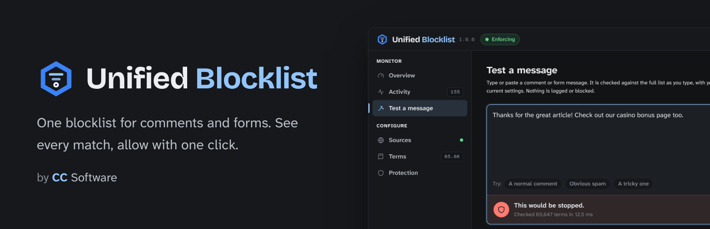
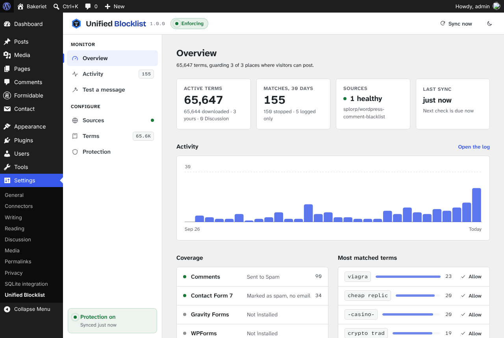
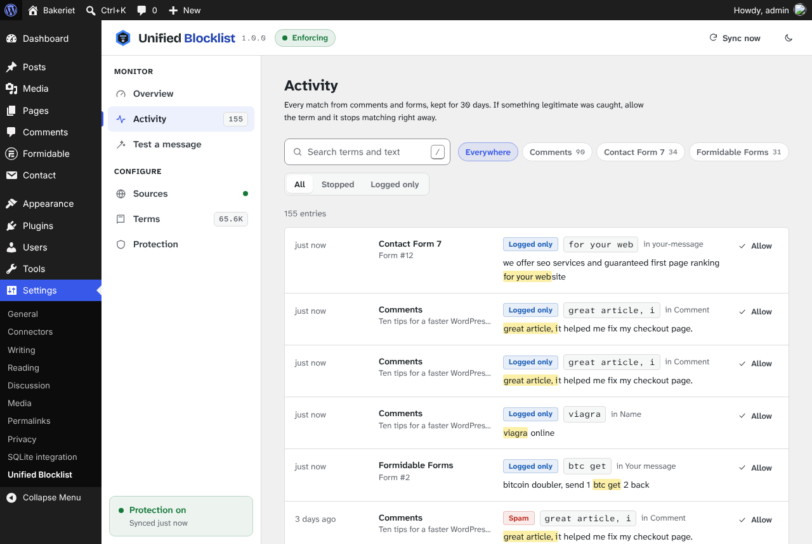
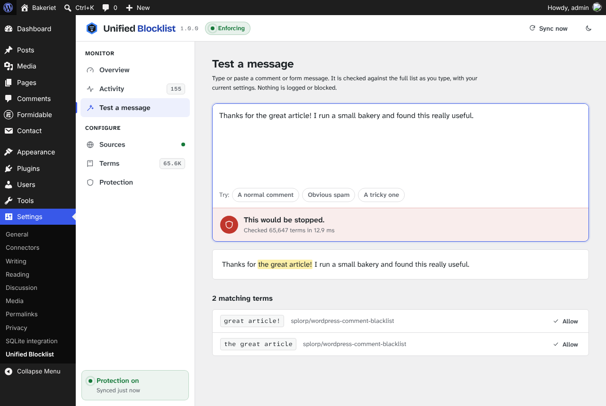
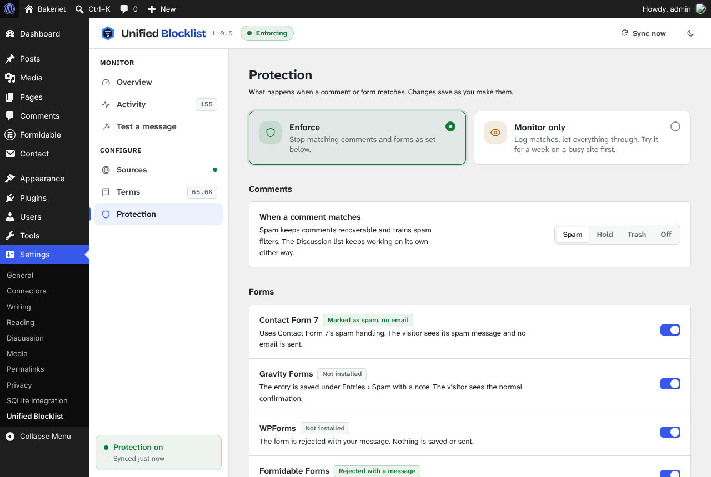

<p align="center">
  
</p>

<p align="center">
  <a href="https://github.com/ClearanceClarence-Software/Unified-Blocklist/actions/workflows/ci.yml"></a>
</p>

Unified Blocklist is a WordPress plugin that keeps one list of blocked terms and applies it to comments and to the form plugins people actually use: Contact Form 7, Gravity Forms, WPForms and Formidable Forms. The list is built from community spam lists that update on a schedule, your own terms, and the terms you already keep in Settings › Discussion. Every match is logged with the text around it, and a term that catches something legitimate is one click away from being allowed.

It is built for sites that get the same spam phrases in the contact form as in the comments, and for agencies that want to maintain one list for many sites instead of pasting into Discussion settings on each of them.

Requires WordPress 6.4+ and PHP 7.4+. Free and GPL. It talks to no server other than the list URLs you configure.

<p align="center">
  
</p>

## Why not just use the Discussion settings?

WordPress has a built-in list of disallowed words, and it is a fine place for a dozen of them. It stops being fine when you paste in a community list of 66,000 terms:

- **It only covers comments.** The form plugins each have their own filters, their own settings pages, and in some cases nothing at all.
- **It is slow.** Core runs one regular expression per term, per field, per comment. With 66,000 terms, that is about 0.9 seconds of CPU for every comment. Unified Blocklist checks the same list in about 6 ms.
- **It is loaded on every page view.** The option is autoloaded, so every request to the site carries almost a megabyte it never uses.
- **You never see what it caught.** Matches go straight to Trash, nothing records which term fired, and a word like *billig* ("cheap" in Norwegian) can silently eat real messages for months.

Unified Blocklist keeps its list out of the autoloaded options, checks it with plain string searches on a single normalized copy of the submission, and writes every match to a log you can search.

## What it does

### One list, five places

| Where | What happens on a match |
| --- | --- |
| **Comments** | Sent to Spam (recoverable, and it trains Akismet), held for moderation, or trashed. Your choice. |
| **Contact Form 7** | Goes through CF7's own spam path: the visitor sees CF7's spam message, no email is sent, and Flamingo keeps it in its spam folder. |
| **Gravity Forms** | The entry is saved under Entries › Spam with a note naming the term. The visitor sees the normal confirmation. |
| **WPForms** | The submission is rejected with your message. Nothing is saved or sent. |
| **Formidable Forms** | The submission is rejected with your message, after Formidable's own validation and spam checks. |

Each integration uses the plugin's native spam mechanism rather than bolting on a generic error, so they behave the way site owners already expect those plugins to behave.

### Sources that keep working

Sources are plain-text lists, one term per line, downloaded on a schedule you pick (hourly to weekly). The plugin ships with no source configured, so nothing is downloaded until you decide. One click on the Sources page adds the community-maintained [WordPress Comment Blacklist](https://github.com/splorp/wordpress-comment-blacklist); add as many others as you like.

Downloads are careful about what they accept:

- Unchanged lists are not downloaded again (ETag and Last-Modified).
- HTTP errors, HTML error pages served as text, and empty responses are rejected.
- A list that suddenly shrinks by more than half is held back until you accept it, so a broken upstream file cannot empty your protection.
- Every source keeps its last good copy. One failing source never affects the others.
- Requests go through `wp_safe_remote_get()`, so local and private addresses are refused.
- Lists are stored compressed and in chunks that stay under MySQL's default `max_allowed_packet`, and every save is read back and verified. If the database refuses a list, you see the database's own error instead of a green checkmark.

### Built to avoid false positives

<p align="center">
  
</p>

- **Activity log.** Every match with where it happened, which field, which term, and a short excerpt with the term highlighted. Search it, filter by place or result, and click **Allow** on any row. The toast has an Undo.
- **Monitor only.** Log matches without blocking anything. Run it for a week on a busy site, read the log, build your exceptions, then switch to Enforce.
- **Whole-word matching** as an option, so "cash" no longer matches "cashew". Community lists are written for substring matching, which stays the default.
- **Minimum term length.** Two-character entries from downloaded lists cause most accidental matches, so terms shorter than three characters are skipped by default. Your own terms are always used.
- **Trusted users are skipped.** Anyone logged in who can moderate comments is never checked.
- **Matching ignores tricks.** Case, HTML entities, zero-width characters and soft hyphens are normalized away before matching, so `vi&#8203;agra` matches `viagra`.

### A tester that explains itself

<p align="center">
  
</p>

Paste a comment or form message and it is checked as you type, with your current settings. You get the verdict, the matching terms highlighted in the text, and which list each term comes from. When something *passes* that you expected to be stopped, it says why: the term is shorter than your minimum, it is in your exceptions, whole-word matching is on, or the list only has longer phrases that contain it. Each reason comes with a one-click fix.

### Dashboard widget

A small card on the WordPress Dashboard: matches for the last 7 and 30 days, a per-day chart, the most matched terms, and anything that needs attention (an empty list, a failing source, Monitor only still on). Rendered by PHP, no JavaScript, so it costs the Dashboard nothing.

### Protection settings

<p align="center">
  
</p>

Everything saves as you change it. The top bar shows the current mode, and a failed save puts the old value back so the screen never shows something that is not stored.

### Moving from Dynamic Blacklist Updater

If the site ran Dynamic Blacklist Updater, the Overview shows a cleanup card. It can deactivate the old plugin, import its custom terms, empty the very large copies it wrote into Settings › Discussion, switch off "Comment must be manually approved" if the old plugin turned it on by mistake, and remove its leftover settings and scheduled task. Each step is a checkbox.

## Install

1. Download `unified-blocklist-<version>.zip` from the [latest release](https://github.com/ClearanceClarence-Software/Unified-Blocklist/releases).
2. In wp-admin, go to Plugins › Add New › Upload Plugin and upload the zip.
3. Activate it, open **Settings › Unified Blocklist**, and click **Add the community list** (or enter your own list URLs and terms). The download starts right away.

That is it for most sites. If you want to be careful on a busy site, open **Protection**, pick **Monitor only**, and come back to the **Activity** log in a few days.

## Settings reference

All settings live in **Settings › Unified Blocklist**.

| Page | Setting | What it does | Default |
| --- | --- | --- | --- |
| Sources | List URLs | Plain-text lists, one URL per line. Saving downloads new lists right away. | Empty |
| Sources | Check for updates | Hourly, twice a day, daily or weekly. | Daily |
| Sources | Hold back lists that shrink | Keep the previous copy if a list loses more than half its terms. | On |
| Terms | Your terms | Added to the downloaded lists, one per line. Kept across syncs. | Empty |
| Terms | Exceptions | Never blocked, whichever list they come from. The Allow buttons add to this. | Empty |
| Terms | Match terms | Anywhere in the text, or whole words only. | Anywhere |
| Terms | Shortest downloaded term | Downloaded terms shorter than this are skipped. | 3 characters |
| Terms | Include the Discussion list | Use the terms in Settings › Discussion › Disallowed Comment Keys for forms too. | On |
| Protection | Mode | Enforce, or Monitor only. | Enforce |
| Protection | When a comment matches | Spam, Hold, Trash, or Off. | Spam |
| Protection | Forms | Switch each form integration on or off. | All on |
| Protection | Rejection message | Shown by WPForms and Formidable. It never says which term matched. | A generic message |
| Protection | Skip trusted users | Never check logged-in users who can moderate comments. | On |
| Protection | Keep log entries for | 7 to 365 days. | 30 days |
| Protection | Store an excerpt with each match | Turn off if submissions may contain personal data you do not want kept. | On |

The light or dark theme is a per-user preference, like in Routemark.

## For agencies and developers

### wp-config.php

Define the sources in code to manage them centrally. The Sources page then shows them read-only.

```php
define( 'UNIFIED_BLOCKLIST_SOURCES', array(
	'https://raw.githubusercontent.com/splorp/wordpress-comment-blacklist/master/blacklist.txt',
	'https://lists.example-agency.no/wordpress-spam.txt',
) );
```

### WP-CLI

```bash
wp unified-blocklist sync                    # download all sources and rebuild
wp unified-blocklist sync --accept-smaller   # also accept lists that shrank
wp unified-blocklist status                  # mode, counts, next sync, per-source state
wp unified-blocklist test "Buy cheap watches here"
wp unified-blocklist rebuild                 # rebuild from stored copies, no download
```

`test` exits with status 1 when something matches, so it works in scripts.

### REST API

The admin screen talks to `/wp-json/unified-blocklist/v1/`, and so can you, authenticated as a user with `manage_options`:

| Method | Route | Purpose |
| --- | --- | --- |
| GET | `/state` | Counts, source health, activity summary, per-day matches |
| GET, POST | `/settings` | Read, or save a partial settings object |
| POST | `/sync` | Sync now (`acceptSmaller: true` to override the shrink guard) |
| GET, DELETE | `/log` | Page through the log (`page`, `perPage`, `context`, `outcome`, `search`), or clear it |
| POST, DELETE | `/exceptions` | Add or remove an exception (`term`) |
| POST | `/test` | Check text (`text`) without logging anything |
| POST | `/legacy` | Run the Dynamic Blacklist Updater cleanup (`steps`) |

### Hooks

```php
// Override any setting from code.
add_filter( 'unified_blocklist_settings', function ( $settings ) {
	$settings['mode'] = 'enforce';
	return $settings;
} );

// Change the final, normalized term list.
add_filter( 'unified_blocklist_terms', function ( $terms ) {
	return array_diff( $terms, array( 'free' ) );
} );

// Decide which fields are checked for one submission.
add_filter( 'unified_blocklist_fields', function ( $fields, $context ) {
	if ( 'comment' === $context ) {
		unset( $fields['Website'] );
	}
	return $fields;
}, 10, 2 );

// Overrule a match, for example to allow one form entirely.
add_filter( 'unified_blocklist_enforce', function ( $enforce, $hit, $context, $fields ) {
	return 'wpforms' === $context ? false : $enforce;
}, 10, 4 );

// Do something on every match. $enforce says whether the integration will act on it.
add_action( 'unified_blocklist_matched', function ( $hit, $context, $enforce ) {
	error_log( "Blocklist: {$hit->term} in {$context} ({$hit->field})" );
}, 10, 3 );
```

## How it is stored

The plugin creates two tables of its own and keeps `wp_options` small.

| Data | Where |
| --- | --- |
| Settings | `wp_options`, one row of about 0.5 KB (autoloaded) plus a few tiny state rows (not autoloaded) |
| Term lists: one copy per source, plus the compiled list | `{prefix}unified_blocklist_lists`, compressed, in rows of under 400 KB |
| Match log | `{prefix}unified_blocklist_log` |
| Theme preference | `wp_usermeta`, one row per user |

No list ever goes into `wp_options`. Anyone who has debugged a site with a bloated options table will know why.

The compiled list is read only when something needs matching: a comment or a form submission, the tester, or the download button. A 66,000-term list takes about 10 ms to load and about 6 ms to check. Uninstalling drops both tables and removes every option and user-meta row.

## Privacy

The plugin contacts only the list URLs you add, and ships with none. It sends nothing about your site beyond a generic `UnifiedBlocklist/<version>` user agent. The log stores the term, the field name and a short excerpt around the match; it never stores IP addresses, and excerpts can be turned off. Trusted users are never checked and never logged.

## A note on community lists

The suggested community list is English-centric and matches substrings. It contains words that are ordinary in other languages, such as the Norwegian *billig*, and ordinary English phrases such as "the great article". On a non-English site, or any site with real traffic, start in **Monitor only**, read the log for a week, and use the Allow buttons. The exceptions you build are kept across syncs.

Keyword lists catch known spam phrases and domains. They do not catch everything, and they are not a replacement for a behavioral filter such as Akismet or Antispam Bee, or a challenge such as a honeypot or Turnstile. Use them together.

## Development

The admin screen is a React app built with `@wordpress/scripts`, the same setup and design system as [Routemark](https://github.com/ClearanceClarence-Software/Routemark). The PHP engine in `src/` works without it; the app only talks to the REST API.

```bash
npm install
npm start          # watch build while developing
npm run typecheck
npm run lint:js
npm run zip        # build + dist/unified-blocklist-<version>.zip
```

PHP follows the WordPress Coding Standards; `phpcs.xml.dist` is included.

| Folder | What's in it |
| --- | --- |
| `src/` | PHP: engine, integrations, REST API, admin mount, dashboard widget |
| `app/` | React admin (TypeScript + SCSS) |
| `build/` | Compiled app, unminified so it can be read as it is (generated, not committed) |
| `licenses/` | Font licenses (Atkinson Hyperlegible, OFL) |
| `.wordpress-org/` | Icon, banners and screenshots for the plugin directory |

The GitHub workflow typechecks, lints, builds, and attaches the plugin zip to every push.

### Brand


Unified Blocklist is a CC Software plugin, so it shares the CC Software look with [Routemark](https://github.com/ClearanceClarence-Software/Routemark). The name is two words. In the wordmark, "Unified" is in the text color and "Blocklist" is in blue.

The mark is the CC Software hex well with a funnel inside it: two bars narrowing down to a single marker, many terms reduced to one decision. The well is always graphite, so the same mark works on light and dark backgrounds.

| | |
| --- | --- |
| Blue `#3B82F6` | Outer hex |
| Light blue `#93C5FD` | Funnel bars, "Blocklist" in the dark theme |
| Dark blue `#1E40AF` | "Blocklist" on light backgrounds, marker center |
| Graphite `#16181B` | Hex well, icon background, dark theme |

The light theme has no palette of its own. It uses wp-admin's grays and the user's admin color scheme (`--wp-admin-theme-color`), so it looks like the rest of the dashboard. The dark theme uses the blues above, with `#2563EB` for the main button. Status colors (green for protection on, amber for Monitor only, red for errors) are the same in both.

The wordmark is set in Bricolage Grotesque. Everything else uses Atkinson Hyperlegible Next and Mono, which keep `l`, `I` and `1` apart; that matters when you are reading spam terms that swap letters for digits. All three are bundled with the plugin under the OFL.

## Credits

Unified Blocklist bundles the Bricolage Grotesque, Atkinson Hyperlegible Next and Atkinson Hyperlegible Mono fonts, all licensed under the SIL Open Font License 1.1. The license text is in `licenses/`. The fonts are served from the plugin folder, not from Google.

The default list is the community-maintained [WordPress Comment Blacklist](https://github.com/splorp/wordpress-comment-blacklist) by Grant Hutchinson.

## License

GPL-2.0-or-later. See [LICENSE](LICENSE).
